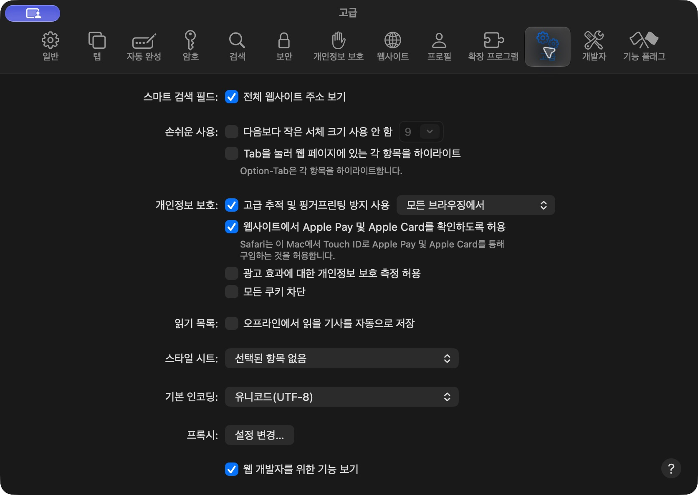
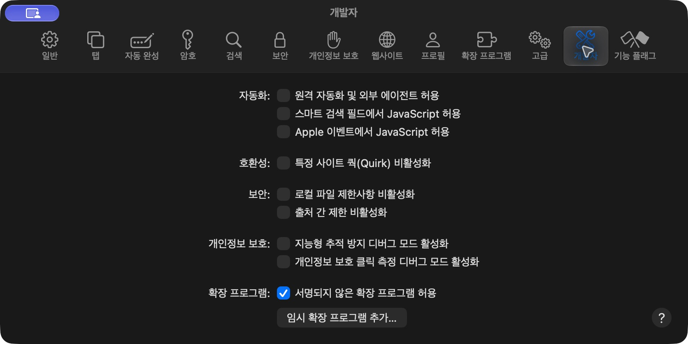

<p align="center"></p>
<h1 align="center">FlowSkip</h1>
<p align="center">감상은 자연스럽게. 반복되는 조작은 가볍게.</p>
<p align="center">Safari용 스트리밍 감상 도우미 · 0.4.2 베타 · GPL-3.0</p>

[다운로드](downloads/FlowSkip-Safari-0.4.2.zip) · [설치 안내](#설치하기) · [자세한 매뉴얼](docs/MANUAL.md) · [개인정보 안내](PRIVACY.md) · [변경 이력](CHANGELOG.md)

FlowSkip은 Netflix, Prime Video, Disney+, Crunchyroll, HBO/Max, Paramount+의 반복되는 재생 조작과 작품 탐색을 돕는 Safari Web Extension입니다. 서비스별 기능은 [Streaming enhanced](https://github.com/Dreamlinerm/Netflix-Prime-Auto-Skip)의 GPL 소스를 바탕으로 하며, 설정 UI와 Safari 저장·통신은 새로 구성했습니다.

> **현재는 개발자용 임시 설치를 사용하는 베타입니다.** App Store 배포판이나 서명된 영구 설치 앱이 아닙니다. 서비스의 화면·언어·지역·요금제에 따라 기능이 달라질 수 있으며, 모든 서비스의 실제 재생을 검증한 정식 버전은 아닙니다.


*설명용 미리보기 모드에서 촬영한 실제 UI입니다. 실제 재생 화면이나 동작 보증을 뜻하지 않습니다.*

## 무엇을 할 수 있나요?

| 서비스 | 주요 기능 |
|---|---|
| Netflix | 오프닝·지난 이야기·엔딩, 시청 확인 자동 응답, 배속, 광고 가속, 프로필 기억, 게임·작품 숨기기, 평점 |
| Prime Video | 오프닝·엔딩, 자체 홍보/광고 처리, 배속, 추가 결제 작품 필터, X-Ray 닫기, 작품 숨기기, 평점 |
| Disney+ | 오프닝·엔딩, 광고 처리, 배속, 작품 숨기기, 평점 |
| Crunchyroll | 오프닝·엔딩·예고, 공개 일정/더빙/중복 필터, 큰 플레이어, 프로필 기억, MAL 평점 |
| HBO / Max | 오프닝·엔딩, 엔딩 끝까지 보기, 배속, 평점 |
| Paramount+ | 오프닝·엔딩, 엔딩 끝까지 보기, 광고 처리, 배속, 평점 |

공통으로 설정 검색, 밝은/어두운 화면, 숨긴 작품 관리, 활동 통계와 백업을 제공합니다. 세부 조작의 서비스별 지원은 원본 엔진에 따릅니다. [전체 설정 대조표](FEATURES.md)를 확인하세요.

- 광고 가속은 Netflix에서 16배속을 우선 요청합니다. 허용되지 않으면 12·8·4배속 순으로 시도합니다. 모든 광고 제거 또는 실제 16배속 재생을 보장하지 않습니다.
- 평점은 선택 기능입니다. **TMDB/MAL 인증 값을 직접 연결해야 합니다.** 원본 크롬 배포판의 내장 인증 값은 포함하지 않습니다.
- Firefox Android 전용 사용자 에이전트 변경은 macOS에서 사용하지 않습니다.

## 설치하기

**준비물:** Mac과 **‘임시 확장 프로그램 추가’가 있는 Safari**. 안내 스크린샷은 Safari 27에서 촬영했습니다. 해당 메뉴가 없는 버전에서는 이 ZIP을 바로 설치할 수 없습니다. 소스 빌드가 아닌 ZIP 설치에는 Node.js나 Xcode가 필요 없습니다.

### 1. 확장 ZIP 다운로드

[FlowSkip-Safari-0.4.2.zip 다운로드](downloads/FlowSkip-Safari-0.4.2.zip). GitHub 화면에서는 파일을 연 뒤 **Download raw file**을 사용하세요. Releases에서 제공하는 경우 같은 이름의 첨부 파일을 받으면 됩니다. **Code → Download ZIP은 소스이므로 설치 파일과 다릅니다.**

### 2. Safari 개발자 메뉴 표시

Safari → **설정**(⌘,) → **고급** → 아래쪽 **웹 개발자를 위한 기능 보기**를 켭니다.



### 3. 임시 확장 추가

설정 → **개발자** → **임시 확장 프로그램 추가…** → 받은 `FlowSkip-Safari-0.4.2.zip` 선택.



서명 허용을 요구하는 경우 신뢰하는 이 개발 빌드에 한해 **서명되지 않은 확장 프로그램 허용**을 선택하세요. 이 옵션은 서명 검사를 완화하므로 출처를 모르는 확장은 추가하지 마세요. 스크린샷의 다른 개발자 옵션은 변경할 필요가 없습니다.

### 4. 켜고 사이트 접근 허용

설정 → **확장 프로그램**에서 **FlowSkip — Safari 감상 도우미**를 켭니다. 사용할 스트리밍 사이트를 열고, Safari의 확장 버튼/권한 안내에서 해당 사이트 접근을 허용합니다. 메뉴 이름은 Safari 버전에 따라 다를 수 있습니다. 모든 사이트를 허용할 필요 없이 이용하는 서비스만 허용하면 됩니다.

### 5. 새로고침하고 사용

스트리밍 탭을 새로고침(⌘R)한 뒤 도구 막대의 FlowSkip 버튼을 누릅니다. 서비스 선택 → 빠른 설정 또는 **모든 기능 보기 ↗**로 이동하세요.


**임시 설치의 수명:** Safari를 종료하거나 24시간이 지나면 임시 확장이 제거됩니다. 다시 추가해야 합니다. 중요한 설정은 ‘설정과 백업’에서 내보내 두세요. [Apple 공식 설치 안내](https://developer.apple.com/documentation/safariservices/running-your-safari-web-extension)를 참고하세요.

## 처음 쓸 때

1. 전체 설정 왼쪽에서 이용하는 서비스를 선택합니다.
2. 원하는 기능을 켭니다. **엔딩 건너뛰기**와 **끝까지 보기** 중 하나를 선택하세요.
3. 변경 후 스트리밍 탭을 새로고침합니다. 새로고침은 재생을 끊을 수 있습니다.
4. 평점이 필요하면 **연결**에서 TMDB/MAL을 설정합니다. 연결하지 않아도 다른 감상 기능을 사용할 수 있습니다.

## 업데이트 / 이전 Scene에서 이동

기존 버전의 **설정과 백업 → 내보내기**로 JSON을 저장 → 기존 확장을 끄거나 제거 → 새 ZIP 추가 → 백업 가져오기 → 사이트 권한 허용 → 탭 새로고침 순서입니다. Scene과 FlowSkip을 동시에 켜지 마세요. Scene Full 백업과 원본 Streaming enhanced의 `settings.json`을 가져올 수 있습니다. 인증 값과 기억한 프로필은 백업에 포함되지 않아 다시 설정해야 합니다.

## 문제 해결

| 증상 | 먼저 할 일 |
|---|---|
| 확장 목록에 없음 | 소스 ZIP 대신 Safari용 ZIP인지 확인하고 개발자 설정에서 추가 |
| 어제는 됐는데 사라짐 | 임시 설치 만료이므로 ZIP 다시 추가 |
| 버튼은 있지만 동작하지 않음 | 해당 사이트 접근 허용, FlowSkip 사용 스위치, 탭 새로고침 확인 |
| 광고 뒤 배속/재생이 이상함 | 해당 서비스의 광고 가속을 끄고 새로고침. 버전·요금제·발생 상황을 이슈로 제보 |
| 평점이 안 나옴 | 연결 값·평점 스위치·API 서버 접근 권한 확인. TMDB는 Read Access Token 사용 |
| 숨긴 작품이 계속 안 보임 | 숨긴 작품에서 복원 후 서비스 탭 새로고침 |

자세한 설명은 [매뉴얼](docs/MANUAL.md)을 확인하세요. 버그를 제보할 때는 비밀번호, API 토큰, 쿠키를 첨부하지 마세요.

## 개발 및 패키징

Node.js **22.12 이상**과 npm이 필요합니다.

```sh
npm ci
npm run build
npm run package
```

`downloads/FlowSkip-Safari-0.4.2.zip`이 생성됩니다. 빌드/패키징은 테스트를 자동 실행하지 않습니다. 개발용 모형 테스트는 필요할 때 `npm test`로 실행할 수 있지만 실제 스트리밍 재생 검증을 대신하지 않습니다.

`index.html`을 열면 홈페이지와 설치 안내를 볼 수 있습니다. `extension/options.html?preview=1`은 로컬 서버에서 UI 미리보기용입니다. 미리보기는 Safari 설정을 저장하지 않습니다.

| 경로 | 내용 |
|---|---|
| `extension/` | 설치 가능한 Web Extension 파일 |
| `source/` | 서비스 엔진, 저장 어댑터, 설정 스키마 |
| `index.html` | 외부 라이브러리 없는 소개·설치 홈페이지 |
| `docs/` | 사용 매뉴얼, 스크린샷, 배포 안내 |
| `scripts/package.mjs` | 확장 ZIP 생성 |

GitHub 공개 및 Pages 설정은 [배포 안내](docs/PUBLISHING.md)를 참고하세요. 서명·공증·App Store 배포는 별도 작업입니다.

## 라이선스와 출처

GPL-3.0. 원본은 Dreamlinerm/Netflix-Prime-Auto-Skip **1.1.108**, commit `12c9d1a9b7e8cf4300f903ad1da1ae115596bb4f`입니다. 변경 내역은 [SOURCE.md](SOURCE.md), 의존성 고지는 [THIRD-PARTY-NOTICES.txt](THIRD-PARTY-NOTICES.txt)에 있습니다. 재배포할 때 라이선스·출처·대응 소스를 함께 제공하세요.

Apple 및 각 스트리밍 서비스의 공식 제품이 아닙니다. This product uses the TMDB API but is not endorsed or certified by TMDB.


## 폴더로 등록한 개발 버전 업데이트

고정된 확장 폴더를 Safari 임시 확장으로 등록했다면 같은 폴더의 파일을 갱신한 뒤 Safari → 설정 → 확장 프로그램 → FlowSkip → **다시 로드**를 누르고 스트리밍 탭을 새로고침하세요. 매번 제거할 필요는 없지만 임시 설치의 유효기간 제한은 그대로입니다. Safari가 자동화 클릭을 차단하면 임시 확장 추가는 사용자가 직접 해야 합니다.
