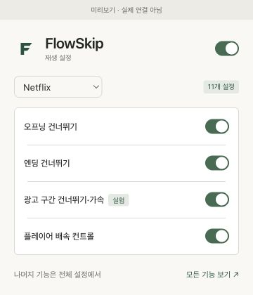
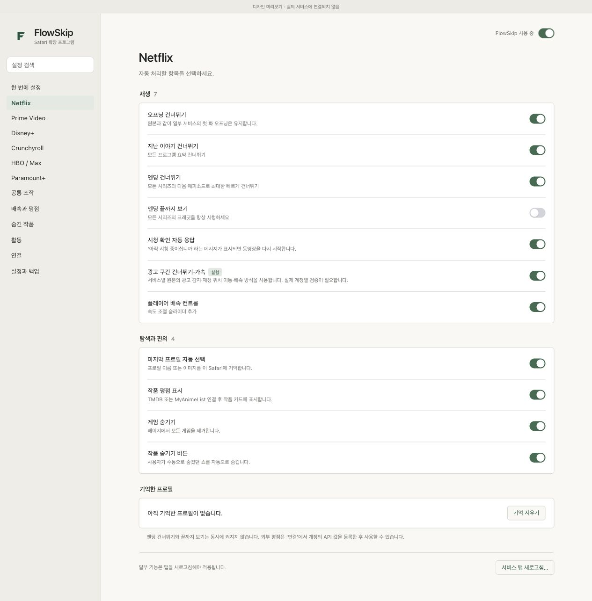
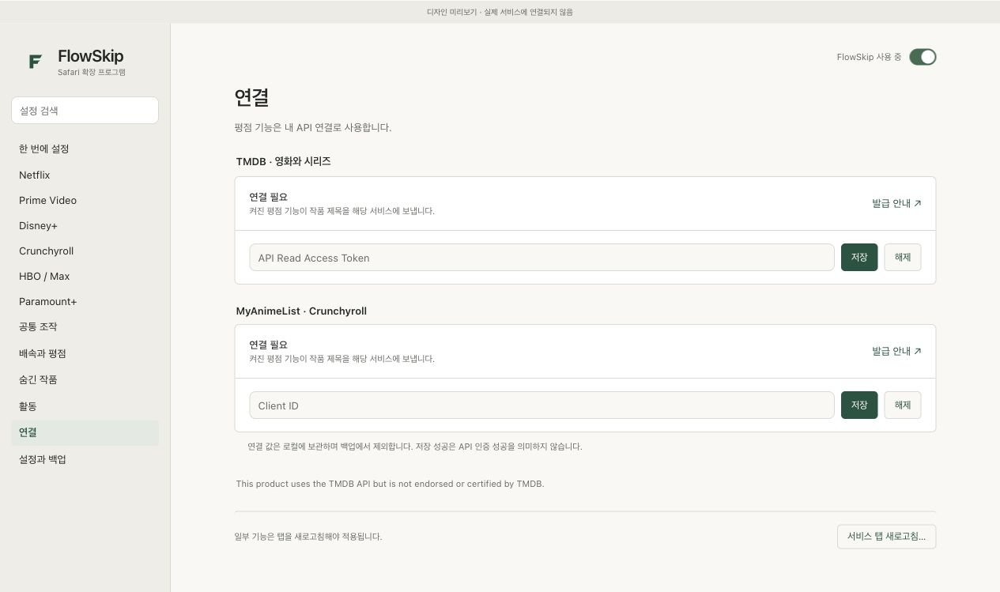

# FlowSkip 사용 설명서

[처음 설치하기](../README.md#설치하기) · [홈페이지](../index.html) · [문제 제보 방법](../CONTRIBUTING.md)

## 1. 어디에서 설정하나요?

Safari 도구 막대의 **FlowSkip**을 누르면 작은 설정창이 열립니다. 먼저 위쪽에서 서비스를 고르세요. 자주 쓰는 네 가지 설정을 빠르게 바꾸거나 **모든 기능 보기 ↗**로 전체 설정을 엽니다.

설정창의 **FlowSkip 사용**을 끄면 자동 처리를 중지합니다. 이미 숨겨진 요소나 페이지에 추가된 컨트롤을 원래대로 되돌리려면 서비스 탭을 새로고침하세요.

## 2. 서비스별 설정

스크린샷은 설명용 미리보기 화면입니다. 왼쪽에서 Netflix 등 이용하는 서비스를 선택하고 오른쪽에서 기능을 조절합니다. 위쪽 검색창으로 ‘배속’, ‘평점’, ‘프로필’을 찾아도 됩니다.

| 설정 | 하는 일 | 알아두면 좋은 점 |
|---|---|---|
| 오프닝 / 지난 이야기 | 서비스의 건너뛰기 버튼을 자동 처리 | 원본 로직에 따라 일부 첫 화 오프닝은 유지 |
| 엔딩 건너뛰기 | 다음 회차로 이동 | 끝까지 보기와 동시 사용 불가 |
| 엔딩 끝까지 보기 | 크레딧 축소/다음 화 안내를 처리 | 서비스에 이 항목이 있을 때 사용 |
| 시청 확인 자동 응답 | Netflix의 계속 시청 확인을 처리 | 원할 때만 사용 |
| 배속 컨트롤 | 플레이어에 배속 조절 추가 | 범위와 간격은 ‘배속과 평점’에서 설정 |
| 광고 구간 처리 | 서비스별 건너뛰기 또는 가속 | 실험 기능. 문제 발생 시 끄고 새로고침 |
| 프로필 자동 선택 | 마지막으로 기억한 프로필 선택 | 프로필을 바꿀 때 기능을 끄거나 기억 지우기 |
| 작품 숨기기 | 서비스 화면에서 작품을 숨기는 버튼 추가 | 복원은 ‘숨긴 작품’에서 |

**배속 키:** 지원하는 플레이어에서 `S`는 느리게, `D`는 빠르게 조절합니다. 입력창에서는 작동하지 않도록 처리합니다. 조절 폭은 서비스별로 다를 수 있습니다.

**Netflix 광고 가속:** 16배속을 우선 요청하고 거부되면 12·8·4배속 순으로 시도합니다. 광고 종료 예상 시점을 뒤로 연장하지 않고 마지막 2초는 원래 배속으로 재생합니다. 강제 음소거는 사용하지 않습니다. 광고 끝의 표시가 늦게 바뀌거나 서비스가 배속을 제한하면 실제 결과가 달라질 수 있습니다. 타임라인 탐색 중과 직후에는 자동 처리를 잠시 멈춥니다.

**Crunchyroll:** 공개 일정 필터, 더빙 언어, 중복 회차, 관심 목록 위주 표시를 조합할 수 있습니다. 공개 일정 페이지를 새로고침해야 페이지 내 필터가 추가될 수 있습니다.

‘한 번에 설정’은 지원 서비스 전체에 같은 값을 적용합니다. ‘공통 조작’의 더블 클릭/스크롤 음량 등은 서비스 플레이어 구조에 따라 동작합니다. Firefox Android 사용자 에이전트 옵션은 macOS 미적용입니다.

## 3. 평점은 선택해서 연결하세요

### TMDB — 영화와 시리즈

1. [TMDB API 설정](https://www.themoviedb.org/settings/api)에서 본인 계정의 API 접근 정보를 준비합니다.
2. **API Read Access Token**을 복사합니다. 일반 API key와 다른 값입니다.
3. FlowSkip → **연결 → TMDB**에 붙여 넣고 저장합니다.
4. API 서버 접근 권한을 요청하면 해당 서버만 허용합니다.
5. 서비스의 **작품 평점 표시**를 켜고 스트리밍 탭을 새로고침합니다.

### MyAnimeList — Crunchyroll

[MyAnimeList API 설정](https://myanimelist.net/apiconfig)에서 Client ID를 준비한 뒤 **연결 → MyAnimeList**에 저장합니다. Crunchyroll의 평점 표시를 켭니다.

‘연결 값 저장됨’은 입력 값이 저장되었다는 의미이며 API 인증 성공을 확인한 표시는 아닙니다. 조회되지 않으면 토큰 종류와 접근 권한을 확인하세요.

원본 크롬 배포판은 개발자가 넣은 인증 값으로 작동합니다. FlowSkip에는 그 값을 포함하지 않으므로 별도 연결이 필요합니다. 연결하지 않아도 건너뛰기·배속 등 다른 기능은 사용할 수 있습니다. 작품 제목이 TMDB/MAL로 전송되며, ‘해제’로 저장된 인증 값을 지울 수 있습니다.

## 4. 숨긴 작품 관리

**숨긴 작품**에서 제목 검색, 서비스/영화·시리즈 필터, 추가일·제목·서비스 정렬을 사용합니다. ‘목록 보기’와 ‘포스터 보기’를 고를 수 있습니다. 포스터 불러오기는 TMDB 연결 후 한 번에 최대 60개를 조회합니다.

- **복원:** 작품 하나를 다시 표시합니다.
- **표시된 작품 선택 → 선택 복원:** 여러 작품을 복원합니다.
- **전체 복원:** 숨긴 작품을 모두 복원합니다. 확인창이 표시됩니다.
- **목록 내보내기/가져오기:** 원본의 숨긴 작품 JSON도 지원합니다. 가져올 때 기존 제목은 유지하고 중복을 제외합니다.

복원 후 해당 서비스 탭을 새로고침해야 화면에 반영됩니다. 포스터나 유형을 못 찾은 작품도 제목으로 관리할 수 있습니다.

## 5. 백업, 업데이트와 삭제

**설정과 백업 → 내보내기**로 JSON을 저장합니다. 설정, 통계, 숨긴 작품이 포함됩니다. API 인증 값과 기억한 프로필은 제외됩니다. 가져오기는 현재 설정·통계·숨긴 작품을 교체하므로 먼저 내보내는 것을 권합니다. Scene Full 백업 및 원본 `settings.json`도 지원합니다. 원본 설정 파일에는 숨긴 작품 목록이 없으므로 목록은 별도로 가져오세요.

업데이트는 **백업 → 이전 확장 제거 → 새 Safari ZIP 추가 → 백업 가져오기 → 권한 허용 → 탭 새로고침** 순서입니다. 여러 버전을 동시에 켜지 마세요.

삭제는 Safari → 설정 → 확장 프로그램 → FlowSkip → 제거입니다. 데이터를 먼저 지우려면 FlowSkip의 **설정과 백업 → 모든 데이터 초기화**를 사용하세요. 초기화는 인증 값과 캐시까지 지우며 되돌릴 수 없습니다.

## 6. 자주 묻는 질문

**Safari를 다시 켰더니 없어졌어요.**
현재 배포는 임시 확장입니다. Safari 종료 또는 24시간 경과 후 다시 추가해야 합니다. [Apple 안내](https://developer.apple.com/documentation/safariservices/running-your-safari-web-extension).

**FlowSkip이 안 보여요.**
Safari용 ZIP인지 확인하세요. 소스 ZIP 전체는 설치할 수 없습니다. 개발자 설정에서 추가한 뒤 확장 프로그램 목록에서 켜세요. 개발자 탭이 없다면 고급 설정의 ‘웹 개발자를 위한 기능 보기’를 확인하세요. 임시 추가 기능 자체가 없는 Safari는 지원 설치 경로가 아닙니다.

**재생이 멈추거나 광고 뒤 배속이 이상해요.**
광고 기능을 끄고 새로고침하세요. 다른 재생 제어 확장과 겹치지 않게 한 버전만 켜세요. 계속되면 Safari/macOS/FlowSkip 버전, 서비스, 광고 요금제 여부, 어떤 조작 뒤 발생했는지 이슈에 적어 주세요. 비밀번호·쿠키·토큰은 올리지 마세요.

**공개된 안정 버전인가요?**
0.4.2은 공개 검토와 사용자 피드백을 위한 베타입니다. 소스·문서·설치 ZIP을 제공하지만 모든 서비스 실재생 호환성, 영구 서명 앱, App Store 배포는 완료되지 않았습니다.

## 폴더로 등록한 개발 버전 업데이트

고정된 확장 폴더를 Safari 임시 확장으로 등록했다면 같은 폴더의 파일을 갱신한 뒤 Safari → 설정 → 확장 프로그램 → FlowSkip → **다시 로드**를 누르고 스트리밍 탭을 새로고침하세요. 매번 제거할 필요는 없지만 임시 설치의 유효기간 제한은 그대로입니다. Safari가 자동화 클릭을 차단하면 임시 확장 추가는 사용자가 직접 해야 합니다.
